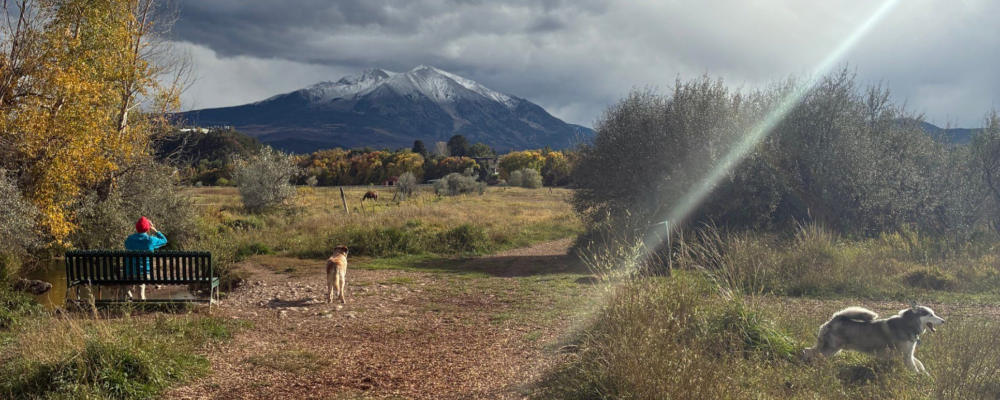

RafikiArdhi is an independent environmental research company built on one idea: **science should stay open.** We publish what we produce, turn validated methods into free tools, and fund that work through the projects we take on.

{.page-banner fig-alt="Mount Sopris above autumn fields near Carbondale, with a person on a bench, two dogs on the trail and horses grazing in the meadow"}

## Open by design

::: {.cards}
::: {.card-item}
### We publish what we produce
Our methods go through peer review and into the scientific literature, with the details needed to reproduce them. Results that shape decisions should be open to scrutiny.
:::
::: {.card-item}
### Free tools
Validated methods become free tools that anyone can use in a browser from the home gardener to the peer reviewer. They run on your own device, so your data never leaves it.
:::
::: {.card-item}
### Paid work funds open work
Projects, advanced analyses and custom development pay for the research. As methods are proven, and agreements allow, they are released openly.
:::
::: {.card-item}
### Credit where it is due
We build on other people's work and cite it clearly: the methods, data and classification systems our tools rely on.
:::
:::

## How a method becomes open

1. **Solve.** We take on environmental problems that existing methods handle poorly.
2. **Validate.** The method is tested against independent data and published.
3. **Release.** A simplified, well-documented version becomes a free tool.
4. **Support.** The full system method, applied to your data and question, is available as a project.

## What is free, and what is a project

::: {.cards}
::: {.card-item}
### Always free
Published methods and open-access papers, the online tools, their documentation and the references behind them.
:::
::: {.card-item}
### Projects
Advanced and continuous versions of the tools, analysis of your data, custom development and training. Client data stays confidential, and client-funded results are never published without an agreement.
:::
:::

## Approach

We build on existing knowledge rather than replacing it. Every map and piece of information is updated, not reset; every estimate propagates its uncertainty; and every result is explained in terms the decision maker can use.

We do not use AI to replace human expertise. Where others reach for black-box AI, we use “glass box” functions: methods that are easy to interpret, scale to large problems, and are benchmarked against AI models.

## Contibutor and acknowledgements

The free tools on this site developed with co-authors, improved by people who tested them, checked the methods and suggested changes.

- **Rosana Kostecki, PhD** ([Profile](https://www.soilconsultoriasocioambiental.com/?utm_source=linktree_profile_share&utm_medium=social&utm_content=link_in_bio)). Soil Consultoria Socioambiental (Soil Socio-Environmental Consulting), Londrina, Paraná, Brazil
- **Zahra Rasaei, PhD** ([Profile](https://www.linkedin.com/in/zahra-rasaei-76aa9378/?isSelfProfile=false)). Faculty of Agriculture, The University of Birjand, South Khorasan, Iran
- **Sara Merzoug** ([Profile](https://www.linkedin.com/in/saramerzoug/?isSelfProfile=false)). Faculty of Applied Sciences Taroudant, Ibn Zohr University, Morocco

Any remaining errors are ours. Found one, or want to suggest a tool? [Get in touch](contact.qmd).

## The name

*Rafiki ardhi* is Kiswahili for "Land friend".

<a class="btn-earth" href="tools.html">Try the tools</a>&nbsp; <a class="btn-earth" href="contact.html">Get in touch</a>

---

*Founded by Trevan Flynn, PhD, soil scientist. See [Research](publications.qmd) for the published research behind our methods.*
