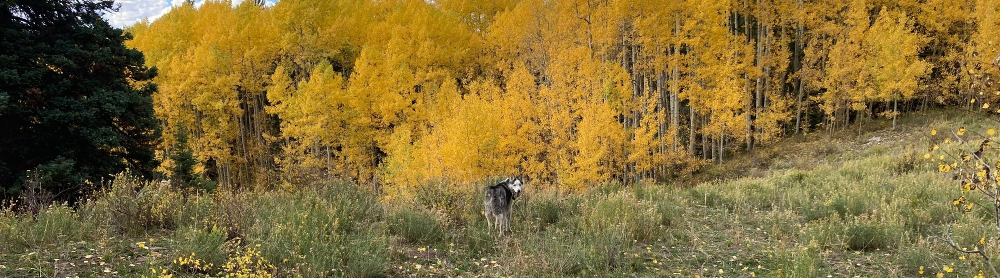

{.page-banner fig-alt="A husky looking back over his shoulder in a meadow below golden aspens in autumn"}

::: {.cards}

::: {}
[]{.bi .bi-envelope} **[Email](mailto:tflynn@rafikiardhi.earth)**

[]{.bi .bi-whatsapp} **[WhatsApp](https://wa.me/RafikiArdhi)**

&nbsp;

RafikiArdhi LLC

Carbondale, Colorado, USA

[ORCID](https://orcid.org/0000-0002-5187-9946) · [LinkedIn](https://linkedin.com/in/trevan-flynn) · [ResearchGate](https://researchgate.net/profile/Trevan-Flynn)
:::

::: {}
::: {.card-item}
### Get in touch about

[]{.bi .bi-check2-circle} A quote for a review or project

[]{.bi .bi-check2-circle} How to use one of the tools

[]{.bi .bi-check2-circle} A problem or error in a tool

[]{.bi .bi-check2-circle} Questions about our methods

[]{.bi .bi-check2-circle} Research partnerships and proposals

[]{.bi .bi-check2-circle} Workshops and training

[]{.bi .bi-check2-circle} Home and garden questions
:::

::: {.card-item .mt-3}
### Contribute to the tools

Our classification keys and tools are offered in several languages so more people can use them in their own. If you would like to translate or review a tool in your language, or co-develop a new key or tool, we would like to hear from you. Contributors are acknowledged on the tools they help build.
:::
:::

:::
