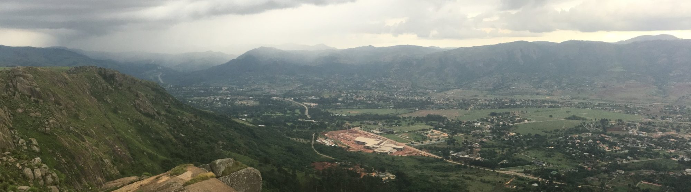

::: {.hero}
[Free tools · Paid thinking · No gatekeeping]{.tagline}

# Answers for environmental questions that don't come off the shelf

[RafikiArdhi brings real science to homeowners and real creativity to researchers. The tools are free. When a question needs more, we bring the thinking.]{.lead}

[Use the free tools](tools.qmd){.btn-earth} &nbsp; [Bring us a problem →](contact.qmd)
:::

::: {.cards}
::: {.card-item}
### [Homeowners: real science](homeowners.qmd)
Everyday decisions about soil, water and gardens, answered with the same science researchers use, without the sales pitch.

:::

::: {.card-item}
### [Researchers: real creativity](tools.qmd)
Free research tools and checks, and new angles on hard environmental problems, with the rigour kept intact.

:::
:::

## What we believe

- **Build on what exists.** Old surveys and past projects are worth more than people think. We update knowledge instead of starting over.
- **Honest uncertainty.** Every answer comes with how far it can be trusted.
- **No AI, no black boxes.** Our methods follow the processes behind the environment, so every result can be traced and checked.
- **Science in your own language.** Our tools and keys come in the languages people actually speak, not only English.
- **Land is shared.** Healthy land includes the animals that live on it.

## How we can help

::: {.cards}
::: {.card-item}
### [Review](services-review.qmd)
Independent second opinions on grants, research designs, models, data and reports.
:::

::: {.card-item}
### [Build](services-build.qmd)
Answers to questions without an off-the-shelf solution, honest about uncertainty.
:::

::: {.card-item}
### [Partner](services-partner.qmd)
Ongoing analytical collaboration with research groups and projects.
:::

::: {.card-item}
### [Learn](services-learn.qmd)
Workshops from do-it-yourself landscaping to research creativity and validation.
:::
:::

## Example: making maps depth-aware

**The problem.** Maps treat soil as a stack of flat layers, so properties jump at every boundary and anything between the standard depths is lost.

**The insight.** Soil isn't layered like a spreadsheet. It forms as one connected profile, so a map should carry it that way.

**The result.** Every pixel now holds a continuous, physically consistent profile. Properties can be read at any depth or totalled over the whole profile, and moisture or temperature can be added to the same framework.

{fig-alt="Six small maps of soil organic carbon across a watershed at depths from 0–20 cm to 100–150 cm, decreasing with depth, beside one larger map of the depth-integrated total showing high values in the north and along drainage lines."}

## Where we work

{.page-banner fig-alt="A valley in eSwatini where settlement is growing into the landscape, under a passing rainstorm"}

[Southern, East and Central Africa · Latin America · United States · Europe. Work is delivered remotely, personally on site or with local partners in the field.]{.regions}

::: {layout="[[1,1],[1,1]]"}
{fig-alt="Two giraffes browsing on acacia trees in green bushveld, with zebra in the background."}

{fig-alt="A city curving around a sandy beach and a wide bay, with a long bridge in the distance."}

{fig-alt="Snow-capped peaks above a wide valley and airport, with oak scrub in the foreground."}

{fig-alt="View from a lookout tower over spruce and beech forest to farmland and rolling hills."}
:::

[See all services →](services.qmd)
