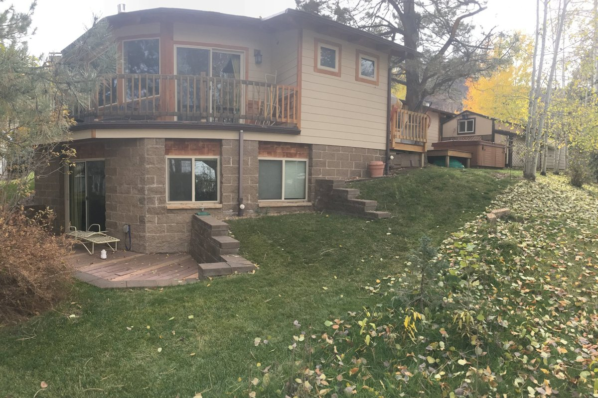
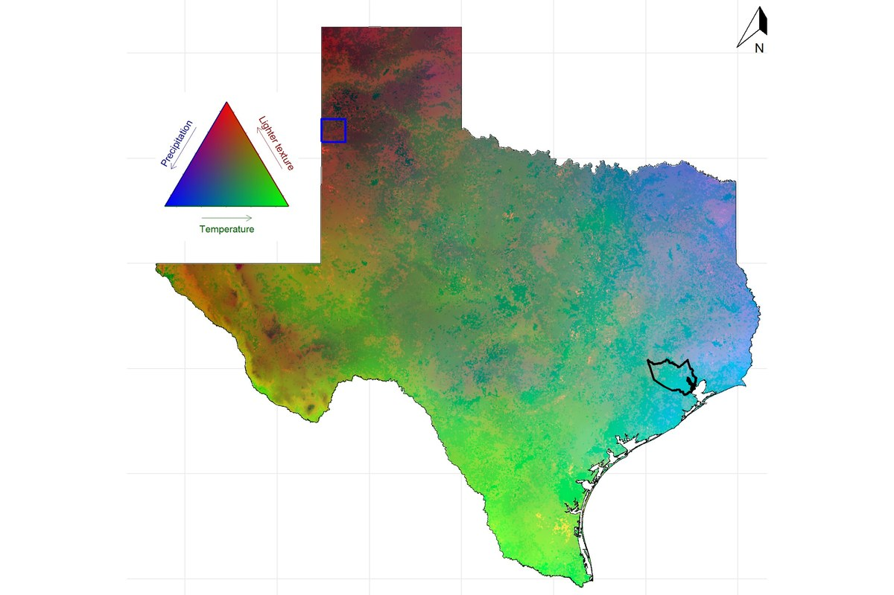
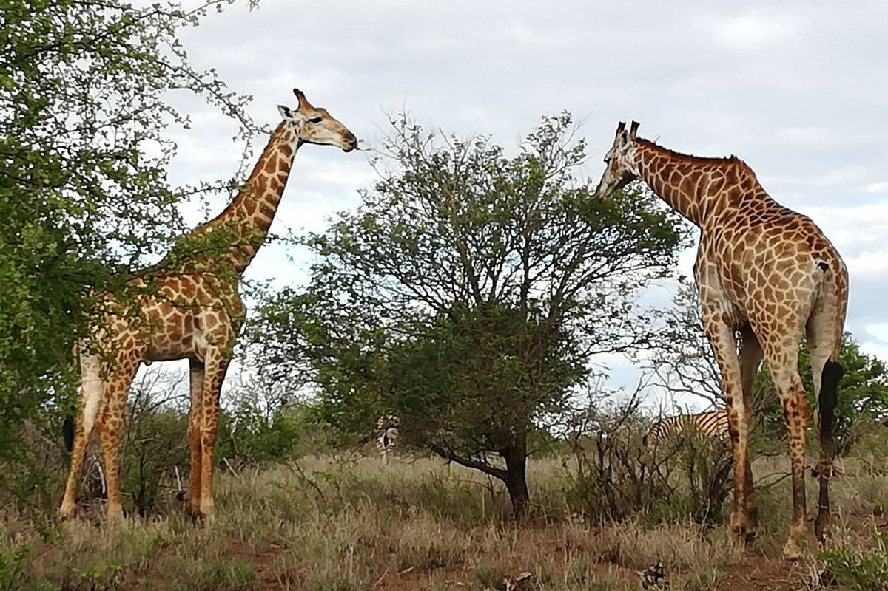
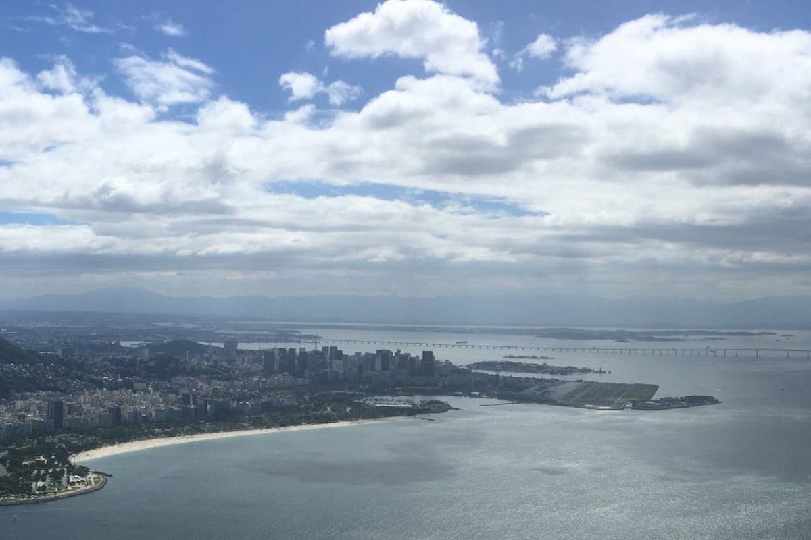
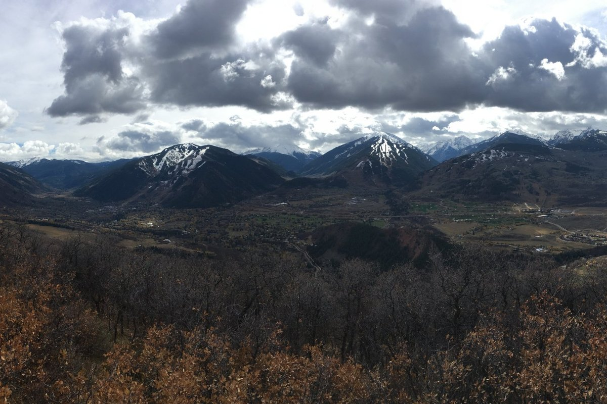
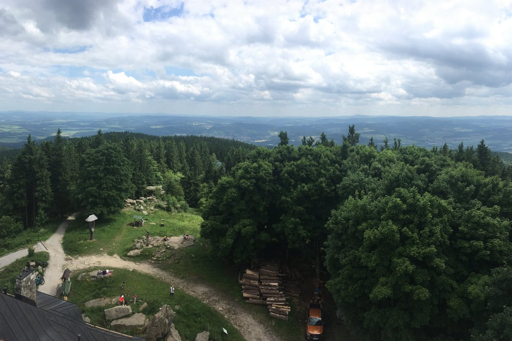

::: {.hero}
[Free tools · Paid thinking · No gatekeeping]{.tagline}

# Your land friend for researchers and homeowners

[Answers for environmental questions that don't come off the shelf. We bring scientific understanding to practical problems and creative thinking to complex ones. Our tools are free and our methods open. When a question needs more, we bring the thinking.]{.lead}{.text-black}

[Use the free tools](tools.qmd){.btn-earth} &nbsp; [Bring us a problem →](contact.qmd)
:::

::: {.cards}
::: {.card-item}
### [Homeowners: open science](homeowners.qmd)
Practical home and landscape decisions informed by the same scientific principles researchers use—from applying Darcy’s and Jurin’s laws to irrigation design to using calculus to estimate sod quantities for irregular lawns.

:::

::: {.card-item}
### [Researchers: creative freedom](tools.qmd)
Let your mind explore the scientific landscape, without compromising scientific rigour. Discover free research tools and checks, creative approaches to difficult environmental problems, and new ways to challenge the possible.

:::
:::

## What we believe

- **Build on what exists.** Old surveys and past projects are worth more than people think. We update knowledge instead of starting over.
- **Honest uncertainty.** Every answer comes with how far it can be trusted.
- **No AI, no black boxes.** Our methods follow the processes behind the environment, so every result can be traced and checked.
- **Science in your own language.** Our tools and keys come in the languages people actually speak, not only English.
- **Land is shared.** Healthy land includes the animals that live with us.

## How we can help

::: {.cards}
::: {.card-item}
### [Review](services-review.qmd)
Independent assessments on grants, research designs, models, data and reports.
:::

::: {.card-item}
### [Build](services-build.qmd)
Answers to questions without an off-the-shelf solution, honest about uncertainty.
:::

::: {.card-item}
### [Partner](services-partner.qmd)
Ongoing analytical collaboration with research groups and projects.
:::

::: {.card-item}
### [Learn](services-learn.qmd)
Workshops from do-it-yourself landscaping to research creativity and validation.
:::
:::

## Where we work

[Southern, East and Central Africa · Latin America · United States · Europe. Work is delivered remotely, personally on site or with local partners in the field.]{.regions}

::: {layout="[[1,1],[1,1]]"}
{fig-alt="Two giraffes browsing on acacia trees in green bushveld, with zebra in the background."}

{fig-alt="A city curving around a sandy beach and a wide bay, with a long bridge in the distance."}

{fig-alt="Snow-capped peaks above a wide valley and airport, with oak scrub in the foreground."}

{fig-alt="View from a lookout tower over spruce and beech forest to farmland and rolling hills."}
:::

[See all services →](services.qmd)
