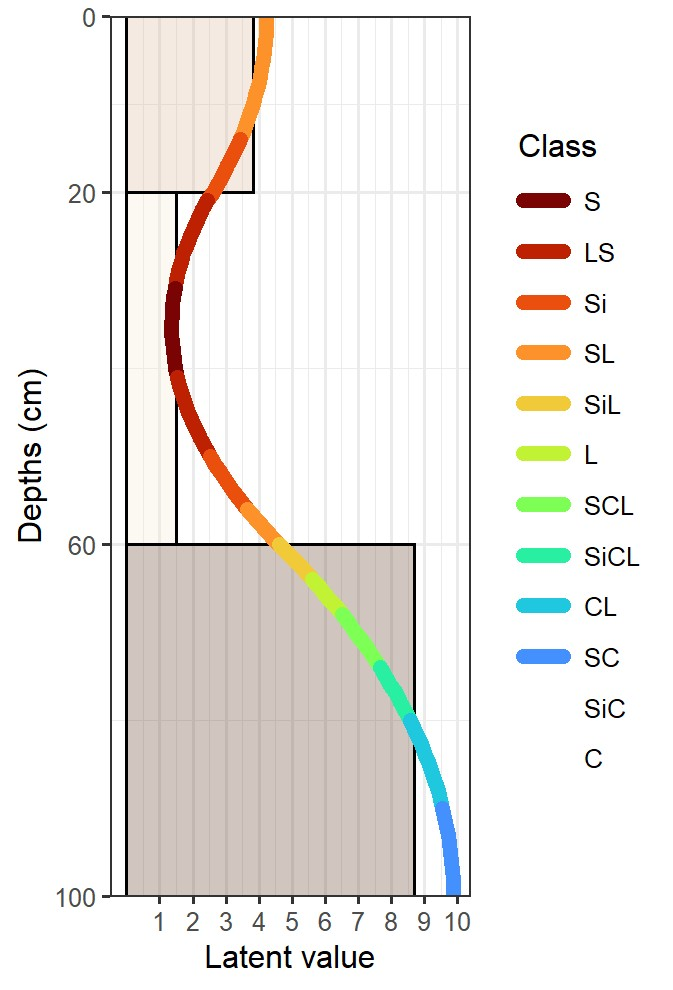
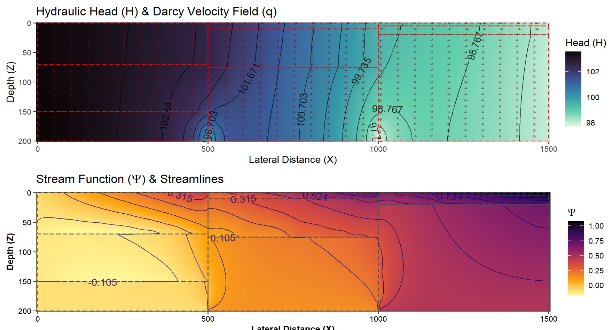
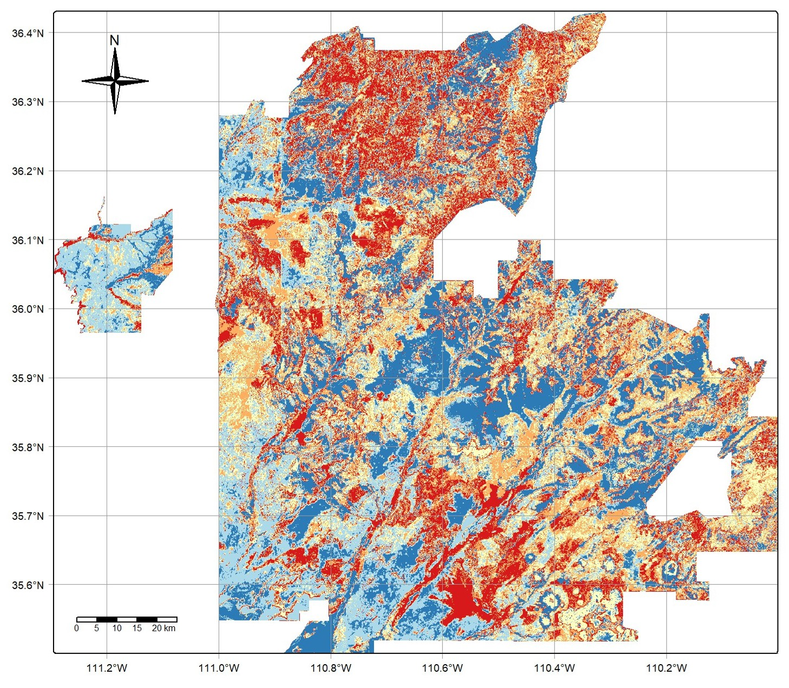
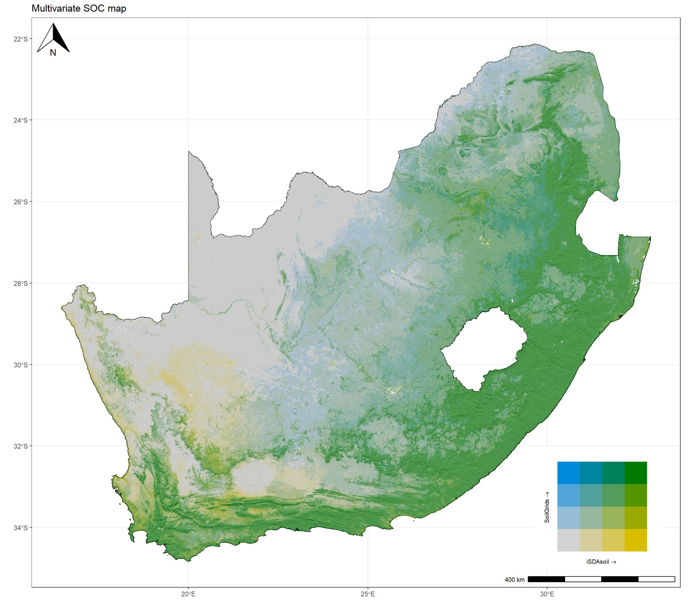
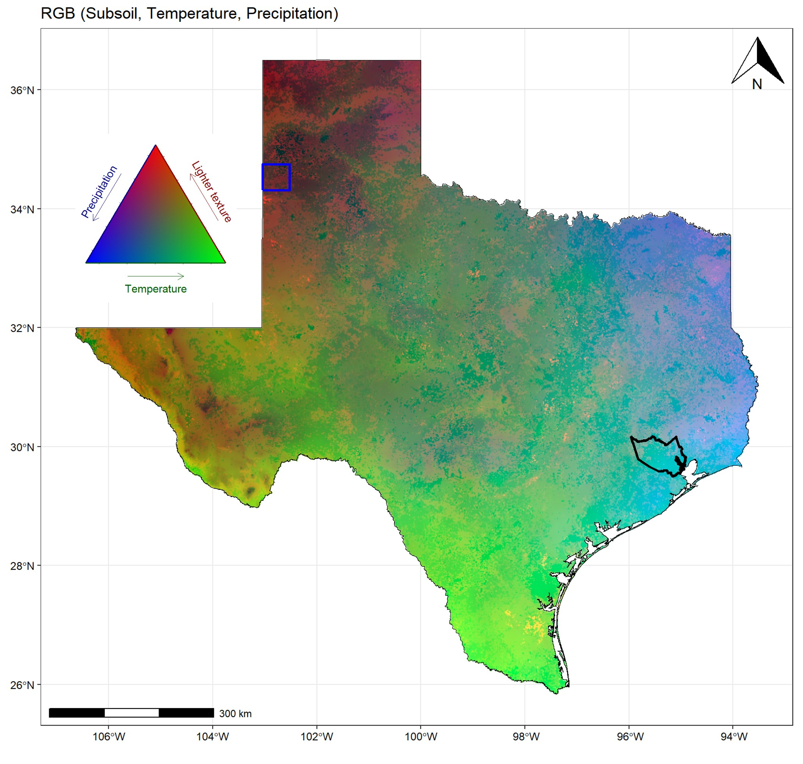

::: {.hero}
[Environmental analytics]{.tagline}

# Evidence for decisions about land, soil and water

[RafikiArdhi turns field data, remote sensing and terrain into maps, models and uncertainty estimates that land managers, researchers and development programmes can act on.]{.lead}

[Get in touch](contact.qmd){.btn-earth}
:::

## What we do

::: {.cards}
::: {.card-item}
### Soil and landscape mapping
Depth-consistent digital soil maps, soil property surfaces and functional domains, from plot to national scale. 

:::

::: {.card-item}
### Hydrology and runoff
Hydrologic soil groups, curve numbers and runoff parameters, and soil-water flux modelling across hillslopes. 

:::

::: {.card-item}
### Geostatistics and uncertainty
Variograms, kriging, mixed models and uncertainty propagation, so every map comes with an honest error estimate. 

:::

::: {.card-item}
### Decision support
Turning model output and its uncertainty into clear, policy-ready classes and priorities. 

:::
:::

## How we work

RafikiArdhi takes on environmental problems where existing methods fall short. We develop a method suited to the problem, validate it against real data, and, where agreements allow, release it as an open tool so the knowledge keeps building rather than resetting with each project.

Clients get the solution, and the expertise to apply it to their own data and decisions.

## Example: making GIS depth-aware

GIS platforms treat soil as a stack of flat layers, so properties jump at every layer boundary and anything between the standard depths is lost. We built a physics-informed depth spline that runs inside Google Earth Engine, turning a spatially explicit platform into one that is also depth-aware. Each pixel carries a continuous, physically consistent profile, so properties can be read at any depth or integrated over the whole profile, and new layers such as moisture or temperature can be added to the same framework.

{fig-alt="Six small maps of soil organic carbon across a watershed at depths from 0–20 cm to 100–150 cm, decreasing with depth, beside one larger map of the depth-integrated total showing high values in the north and along drainage lines."}

## Where we work

[Southern, East and Central Africa · the Caribbean and Latin America · the Western United States. Work is delivered remotely, personally on site or with local partners in the field.]{.regions}

[See all services →](services.qmd)
