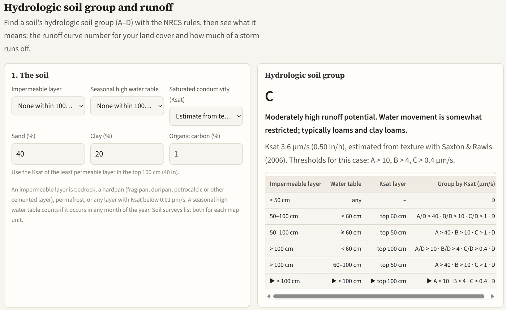

The island has never had a soil survey, yet flood models need to know how much water the soil holds and how much runs off. What makes this project different is that uncertainty propagation guides every step: the hydropedological assumptions, the models, and the decisions built on them.

{fig-alt="Screenshot of the RafikiArdhi hydrologic soil group tool: soil inputs on the left, and on the right the result, group C, with the saturated conductivity estimate and the NRCS decision table."}

[Try the free tool →](../tools.qmd#hsg)
