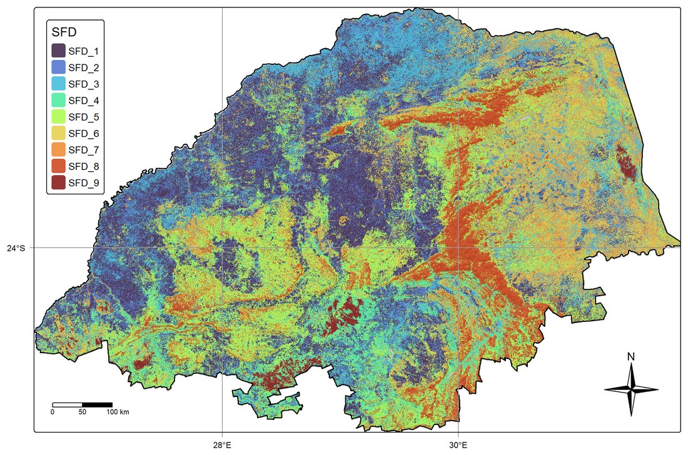

Environmental knowledge keeps getting reset. A new survey, a new map or a new project arrives, and the last one is quietly replaced, along with everything it cost and everything it knew.

We're working on the opposite: updating what is known as new data arrives, so that knowledge accumulates and uncertainty falls with each round instead of starting over. In Limpopo, South Africa, a continental soil survey is used to update regional soil fertility maps into domains that support land-use decisions.

{fig-alt="Map of Limpopo Province coloured into nine soil fertility domains, from dark purple and blue for lower fertility to orange and dark red for higher fertility, with large connected regions following the landscape."}

The method is an updated version of our [ISPM](southern-africa-depth.qmd) digital soil mapping framework, built on the idea that the whole is greater than the sum of its parts. The updating is physics-based: it obeys the laws of thermodynamics and is solved exactly with calculus, rather than learned by AI. Every update can be traced, checked and explained, and the knowledge it adds is never lost to a black box.

(Manuscript under production)
