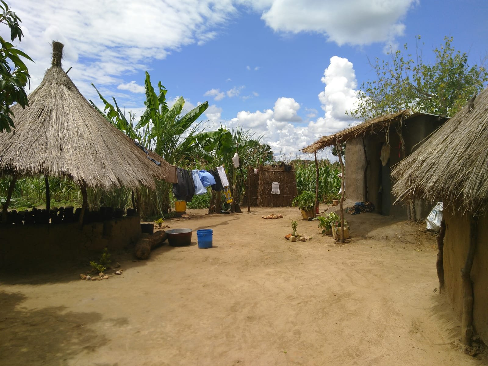

{fig-alt="A swept earth yard between thatched round huts and mud-walled houses, with laundry on a line and maize and banana plants behind."}

Working with women farmers on heavily leached soils, with very limited resources.
