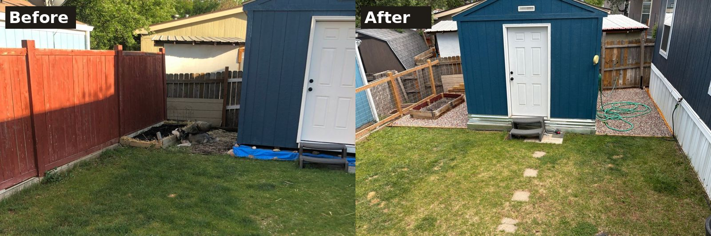
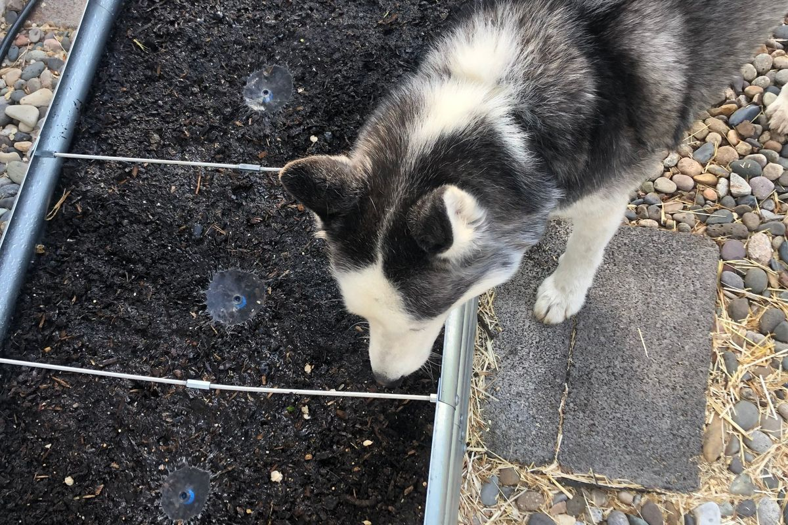

We test our homeowner tools where it matters most to us: at home. A patch of lawn and bare ground became gravel paths, raised beds and drip irrigation, with every quantity of soil, mulch and gravel worked out first with the same free calculators on our [Homeowners page](../homeowners.qmd).

{fig-alt="Two photos side by side of the same backyard with a blue shed: before, with bare ground and a rough bed by the fence; after, with neat gravel borders, a raised bed and a hose."}

{fig-alt="A husky sniffing a raised garden bed of dark soil with drip irrigation emitters, each surrounded by a circle of wet soil."}
