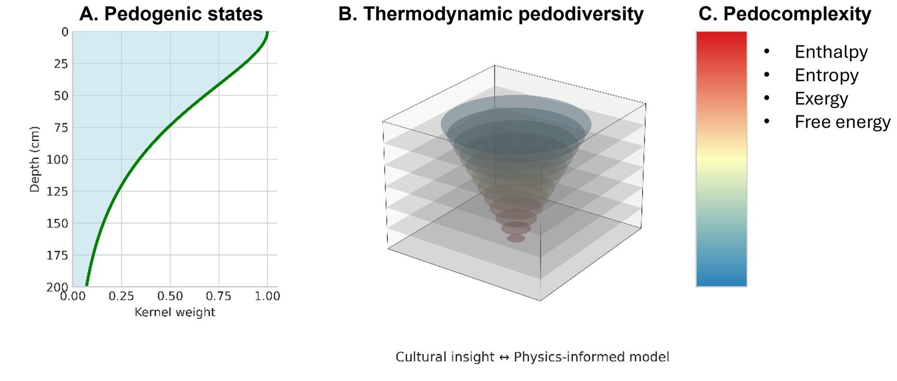

Soils are not random mixtures. They organise themselves over time, using and releasing energy as water, heat and carbon move through them, and that organisation is what lets a soil absorb shocks and keep doing many jobs at once. We measure it with thermodynamics rather than by counting soil types: pedodiversity reflects how a soil dissipates energy relative to what it has available.

In the U.S. Southwest, this approach revealed agroecosystem patterns on Indigenous lands, from the Chuska Mountains to the Great Sage Plain and Hopi land, where generations of land use and soil organisation are written into the landscape.

{fig-alt="Three-part graphical abstract: a depth curve of soil states, a three-dimensional block showing a cone of soil organisation narrowing with depth, and a colour scale listing enthalpy, entropy, exergy and free energy, with the caption cultural insight and physics-informed model."}

**Preprint:** [Thermodynamic pedodiversity patterns reveal agroecosystem patterns in Indigenous lands of the U.S. Southwest](https://doi.org/10.32942/X2H66M)
