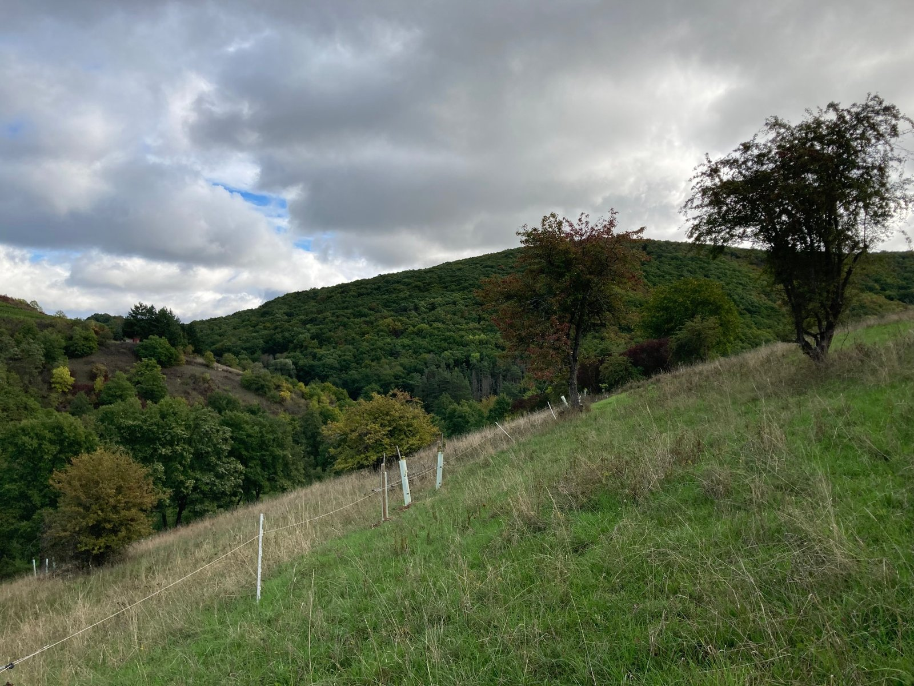

Soil is not a random mixture. Soil organises itself over time, using and releasing energy as water, heat and carbon move through, and that organisation is what lets soil absorb shocks and performs many ecosystem services at once. We measure it with thermodynamics rather than by counting soil types: in other words, pedodiversity reflects how a soil dissipates energy relative to what it has available.

{fig-alt="A grassy hillside with a line of tree guards and an electric fence, below a forested hill under grey clouds."}

In the U.S. Southwest, this approach revealed agroecosystem patterns on ancestral and contemporary Indigenous lands, from the Chuska Mountains to the Great Sage Plain and Hopi Land, where generations of land use and soil organisation are written into the landscape. The original preprint focused on this area because of our knowledge of, and closeness to, the land, but it raised more questions than it answered. Humanity’s tie to the land is not unique to this region, and the questions that run from pedodiversity to pedocomplexity can be studied at many scales and with many techniques, for the wellbeing of both ecosystems and people. 

{fig-alt="Three-part graphical abstract: a depth curve of soil states, a three-dimensional block showing a cone of soil organisation narrowing with depth, and a colour scale listing enthalpy, entropy, exergy and free energy, with the caption cultural insight and physics-informed model."}

**Preprint:** [Thermodynamic pedodiversity patterns reveal agroecosystem patterns in Indigenous lands of the U.S. Southwest](https://doi.org/10.32942/X2H66M)
