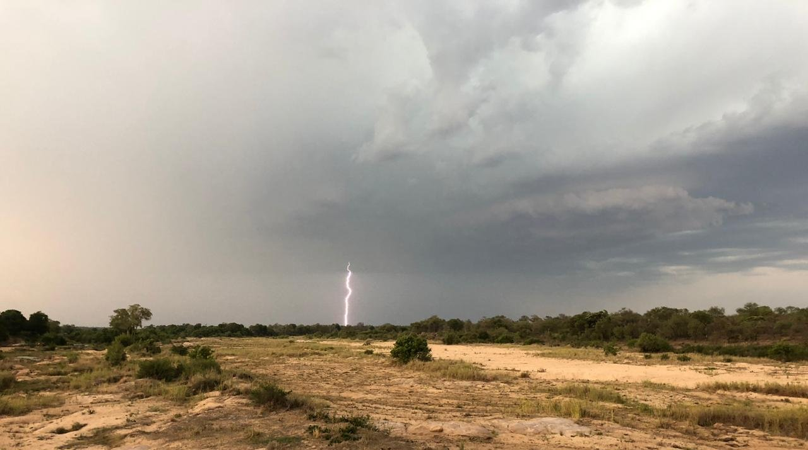
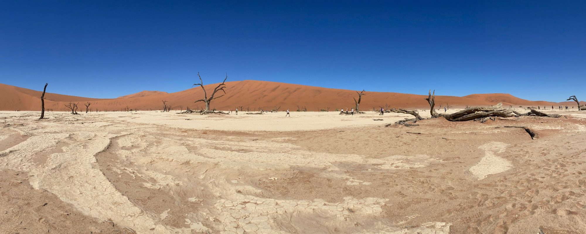

{fig-alt="Lightning striking beyond a wide dry sandy riverbed lined with bush, under dark storm clouds."}

Most soil science treats soil as something that sits still. We are treating it as a system in motion: water moving through it in drought and in flood, heat and energy flowing with it, and the soil organising itself around that flow over time.

The key is exergy: the share of energy a soil can actually put to work, rather than the total energy passing through it. What matters is not how much energy a soil receives, but how well it uses what it has.

That changes how soil is perceived. A desert soil can seem "dead": bare, crusted and pale. Yet with very little rain and energy, it may be doing its jobs remarkably well. Its surface crust holds the ground together and fixes nutrients, it stores water deep where it does not evaporate, and it locks away carbon for thousands of years. A tropical soil under lush forest can look full of life, yet much of that richness sits in the plants, not the soil. Many tropical soil is deeply weathered and hold few nutrients of its own, and clear the forest and that apparent fertility can disappear within a few seasons. Judged against the energy each has available, the desert soil may function for the ecosystem just as well.

To capture this, we are bringing mathematics from outside soil science into it, linking how energy moves with how soil organises, functions and recovers. The work spans drylands to the tropics, from the Western United States to the Malawi, with a students leading the charge.

{fig-alt="A white cracked clay pan with dead camel thorn trees in front of tall red dunes under a deep blue sky."}

Details stay under wraps until the work is published.

For additional experts in the this field, see [about](../about.qmd) page
