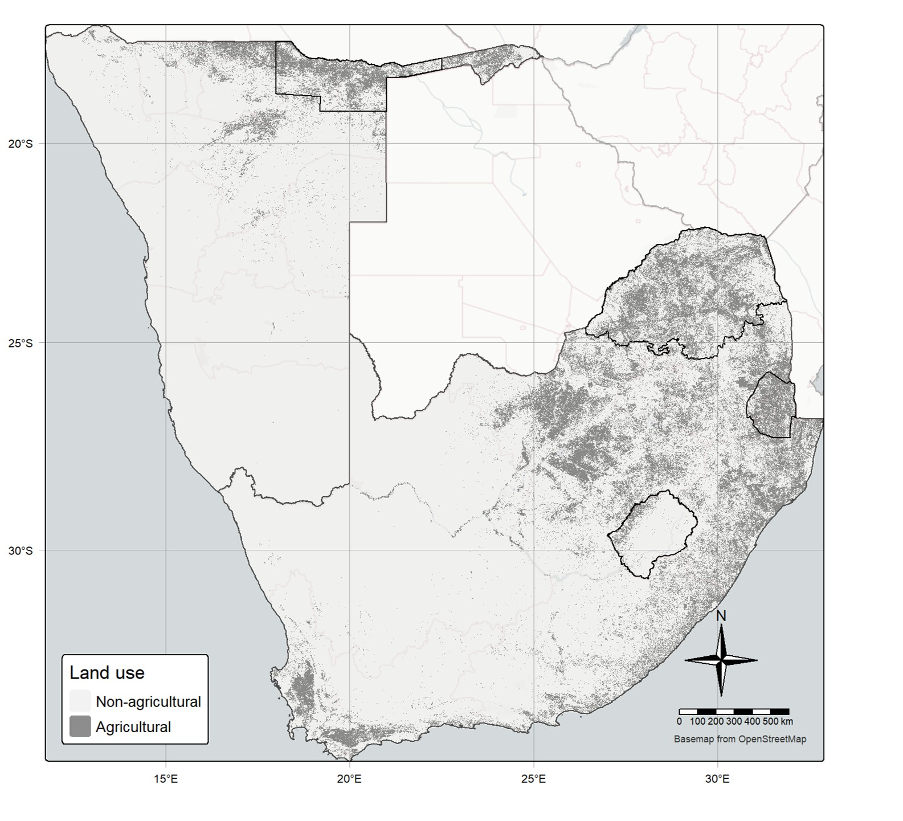

{fig-alt="Mapped area showing agricultural land and non-agricultural land."}

Soil properties mapped consistently with depth across Eswatini, Lesotho, Namibia and South Africa, so that maps no longer jump at every layer boundary. Sampling was sparse, only two horizons were sampled per profile, and the environmental gradients were extreme, so we developed a new method for the project: Integrated Soil Profile Mapping (ISPM). It builds on our earlier physics-informed depth spline ([phySpline](https://doi.org/10.1016/j.scitotenv.2026.181621)) and is now being extended to update existing soil maps and support decisions. See [Now: cumulative knowledge](cumulative-knowledge.qmd). 

**Preprint:** [Integrated soil profile mapping reveals regional patterns of soil condition across Southern African agricultural lands](https://doi.org/10.31223/X5JN5T)
