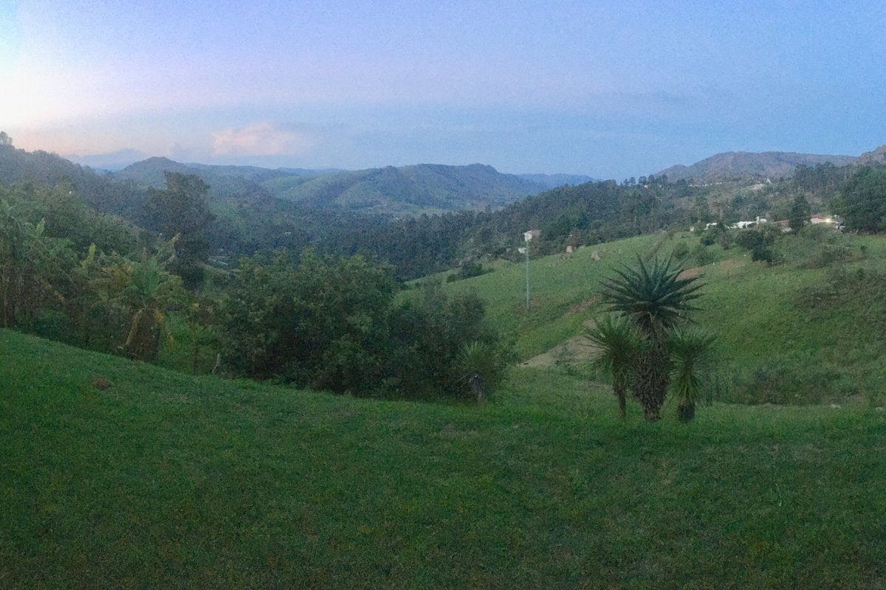
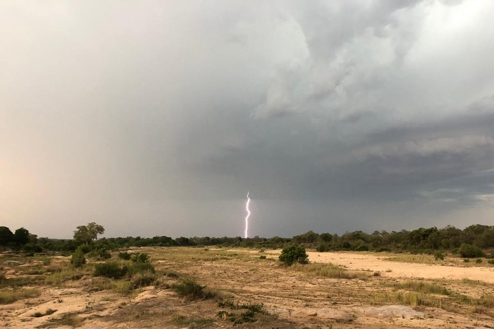
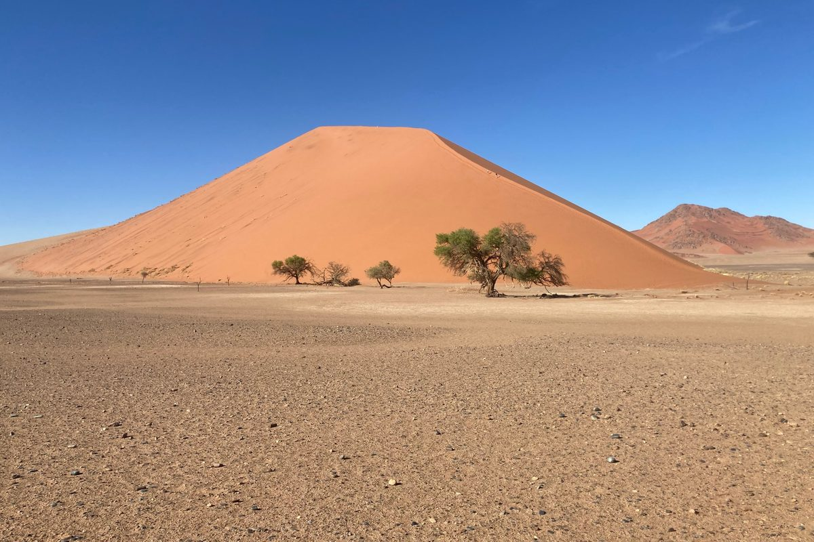

Soil properties mapped consistently with depth across Eswatini, Lesotho, Namibia and South Africa, so that maps no longer jump at every layer boundary. The research formed part of [Soils4Africa](https://www.soils4africa-h2020.eu/), an EU Horizon 2020 project building an open-data Soil Information System to help farmers, agri-businesses, scientists and policymakers by improving the quality and availability of African soil data.

{width="65%" fig-align="center" fig-alt="Map of southern Africa showing agricultural land in dark grey and non-agricultural land in light grey across Namibia, South Africa, Lesotho and Eswatini."}

Sampling was sparse, only two horizons were sampled per profile, and the environmental gradients were extreme, so we developed a new method for the project: Integrated Soil Profile Mapping (ISPM). It builds on our earlier physics-informed depth spline ([phySpline](https://doi.org/10.1016/j.scitotenv.2026.181621)) and is now being extended to update existing soil maps and support decisions. See [Cumulative knowledge](cumulative-knowledge.qmd). 

::: {layout-ncol=3}
{fig-alt="Green rolling hills and forested valleys at dusk, with an aloe in the foreground."}

{fig-alt="Lightning striking beyond a wide dry sandy riverbed lined with bush, under dark storm clouds."}

{fig-alt="A tall red sand dune with a few camel thorn trees on a flat gravel plain under a clear blue sky."}
:::

**Preprint:** [Integrated soil profile mapping reveals regional patterns of soil condition across Southern African agricultural lands](https://doi.org/10.31223/X5JN5T)
