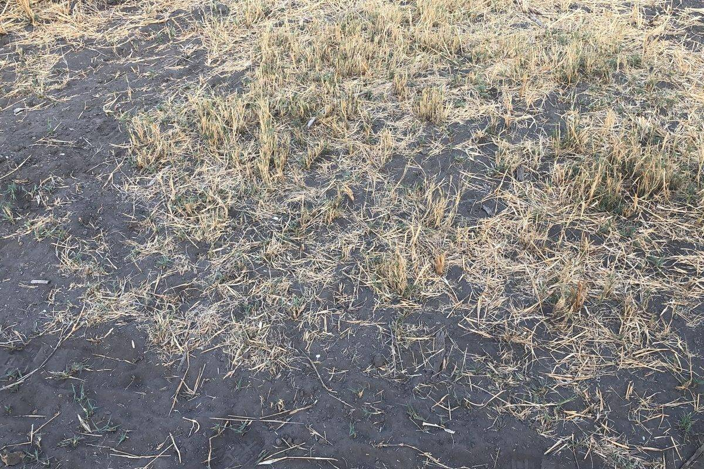

Invasive bush is spreading across Southern African rangelands, choking grazing land and water. Clearing it can restore land, livelihoods and can be used as a source of biofuel for a home stove or power plant; however, what does it do to the carbon stored in the soil?

As a research consultant to [SLU](https://www.slu.se/en/research/research-catalogue/projekt/s/steambioafrica/) (the Swedish University of Agricultural Sciences) on SteamBioAfrica, an EU Horizon 2020 project turning invasive woody biomass into products that benefit local communities, we modelled soil carbon dynamics during and after de-bushing and pesticide use in Namibia, Botswana and South Africa.

{fig-alt="Close-up of dark bare soil partly covered with dry straw and residue after clearing."}
