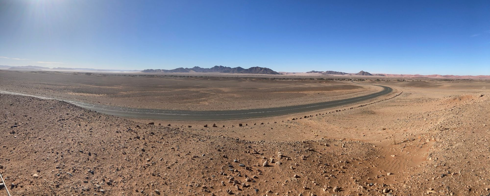
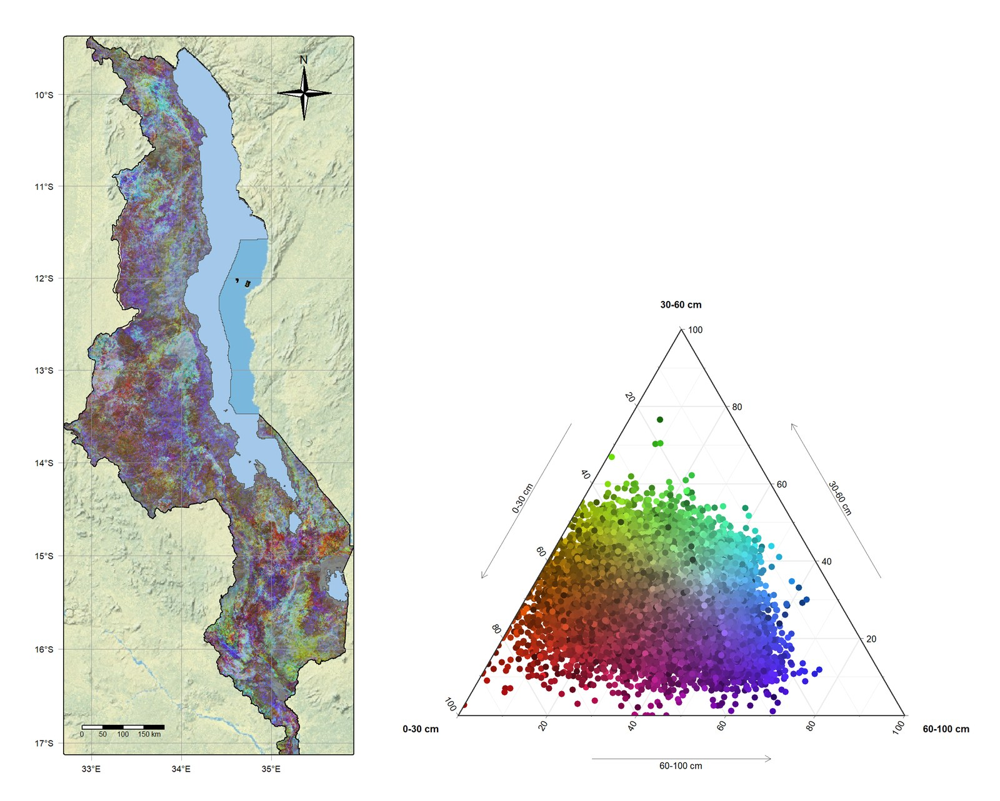

{.page-banner fig-alt="A road crossing the gravel plains of the Namib Desert, Namibia, with red dunes on the horizon"}

Some environmental questions don't have an off-the-shelf answer. That's where we start.

::: {.cards}

::: {.card-item}
### When the data runs out
No survey, no gauges, no budget for fieldwork. We build defensible answers from what already exists, and we're honest about what that costs in certainty.
:::

::: {.card-item}
### Don't start over
Old surveys and past projects are worth more than people think. We update and combine what has already been paid for instead of starting again.
:::

::: {.card-item}
### New problem, new method
When no method fits, we design one, test it and write it down so others can check it.
:::

::: {.card-item}
### How sure are we?
Every answer comes with its uncertainty. Knowing where a map can't be trusted is as valuable as the map.
:::

::: {.card-item}
### From results to decisions
Turning model outputs into choices people can act on, explained so your funder, your council and your neighbour all understand it.
:::

::: {.card-item}
### Glass box, not black box
Methods you can open up and audit, tested against AI rather than replaced by it.
:::

::: {.card-item}
### Beyond the free tools
The deeper version of any tool on this site, built for your problem.
:::

:::

{fig-alt="A map of Malawi beside Lake Malawi coloured in reds, greens, blues and purples, next to a triangle plot of thousands of coloured points with corners labelled 0–30 cm, 30–60 cm and 60–100 cm."}

You receive a licence to use the methods and results built for you. RafikiArdhi keeps the methods themselves and may later release an open version. Engineering work that requires a licensed professional engineer is carried out alongside that engineer.

[Bring us a problem →](contact.qmd){.btn-earth}
