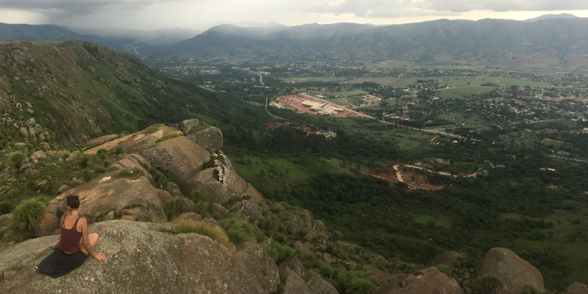

{.page-banner fig-alt="Looking out over a valley in eSwatini, where settlement is growing into the landscape under a passing rainstorm"}

Workshops tailored to the group, from homeowners and field teams to research students, and available in several languages.

::: {.cards}

::: {.card-item}
### Soil classification
Describing and classifying soils in the field with WRB and national systems, using our free classification keys.
:::

::: {.card-item}
### Do-it-yourself landscaping
Put our homeowner tools together and make home gardening both fun and scientific, without the stress.
:::

::: {.card-item}
### Research creativity
Think outside the box while keeping scientific rigour, to solve complex environmental challenges.
:::

::: {.card-item}
### Research validation
Quantifying, propagating, communicating and visualising scientific results for every audience, from your mother to the neighbour who doesn't speak your language.
:::

:::

[Plan a workshop →](contact.qmd){.btn-earth}
