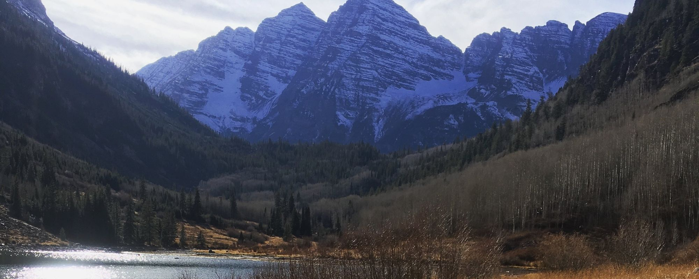

{.page-banner fig-alt="The Maroon Bells above Maroon Lake near Aspen, Colorado"}

A check by someone with no stake in the outcome, before you submit, publish or act. Each review has a fixed scope and price agreed in advance, and you receive written comments you can act on.

::: {.cards}

::: {.card-item}
### Grant proposals
Pre-submission review of aims, methods and feasibility, and whether the budget matches the work.
:::

::: {.card-item}
### Research and sampling design
Sample size, spatial layout, statistical power, and whether the design can answer the question being asked.
:::

::: {.card-item}
### Models
Statistical, geostatistical and process models: assumptions, validation, overfitting and data leakage, and how uncertainty is handled.
:::

::: {.card-item}
### Data
Quality, gaps, harmonisation problems, and whether the data supports the claims made from it.
:::

::: {.card-item}
### Reports and manuscripts
Pre-submission review of the analysis and the inference drawn from it.
:::

::: {.card-item}
### Consultant deliverables
A check of a study you have paid for, such as a flood, soil or site assessment, before you act on it. Short second opinions are available for homeowners as well.
:::

:::

> We only review work for the people who own it: applicants, authors or clients. We don't take paid reviews of proposals or manuscripts we are assessing for a funder or journal, and everything you share stays confidential.

[Request a review →](contact.qmd){.btn-earth}
