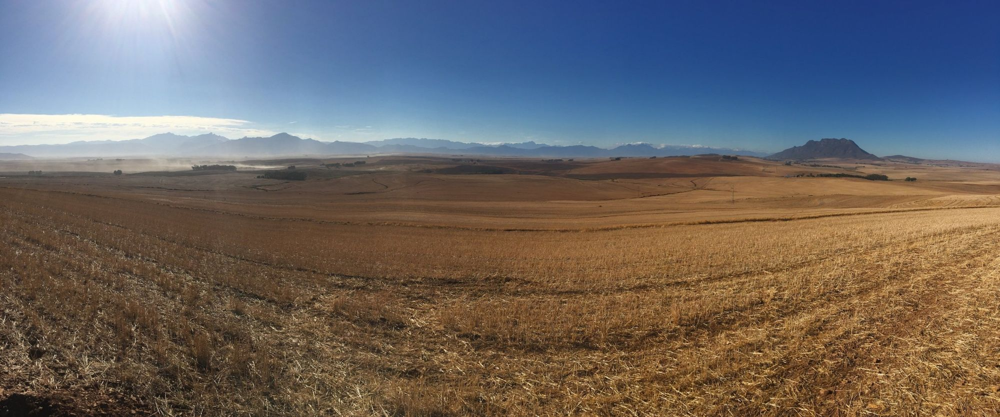
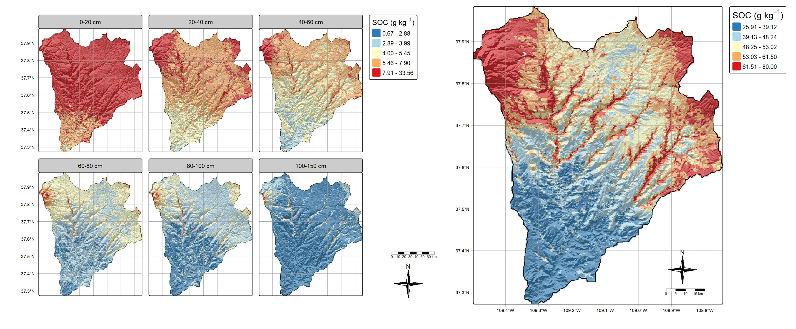

{.page-banner fig-alt="Harvested wheatlands in the Swartland, Western Cape, South Africa, with dust blowing off the fields"}

The tools on this site are free. What we charge for is the thinking behind them: working out what a question really needs, building methods where none exist, and checking that conclusions hold up. 

For homeowners, we bring actual science to everyday decisions about soil, water and gardens, so you're not guessing or relying on a sales pitch. For researchers, we bring creativity: new angles on hard problems, without giving up rigour. Either way, some questions don't have an off-the-shelf answer, and that's where we start.

### Ground rules
Every engagement starts with a short written scope that sets out the question, deliverables, timeline and price before any work begins.

Collaboration on manuscripts is not a RafikiArdhi project, and RafikiArdhi LLC holds no intellectual property in it, unless the company is named in the proposal or grant. If you’re looking for expertise in a particular discipline for a manuscript, please contact the relevant contributor of the tools directly.

Thesis and dissertation advice is offered only with the approval of the student’s supervisor and under an agreement with the university.

::: {.cards}

::: {.card-item}
### [Review](services-review.qmd)
Independent second opinions on grant proposals, research designs, models, data, reports and consultant deliverables. Fixed scope, fixed price.
:::

::: {.card-item}
### [Build](services-build.qmd)
Answers to environmental questions without an off-the-shelf solution, built on what already exists and honest about uncertainty.
:::

::: {.card-item}
### [Partner](services-partner.qmd)
Ongoing analytical collaboration with research groups and projects, and methods leadership on proposals.
:::

::: {.card-item}
### [Learn](services-learn.qmd)
Workshops in soil classification, do-it-yourself landscaping, research creativity and research validation, in several languages.
:::

:::

## Why be creative in science?

**[An example]{.small .text-muted}**

**The problem.** Maps treat soil as a stack of flat layers, so properties jump at every boundary and anything between the standard depths is lost.

**The insight.** Soil isn't layered like a spreadsheet. It forms as one connected profile, so a map should reflect this information.

**The result.** Every pixel now holds a continuous, physically consistent profile. Properties can be read at any depth or totalled over the whole profile, and moisture or temperature can be added to the same framework.

{fig-alt="Six small maps of soil organic carbon across a watershed at depths from 0–20 cm to 100–150 cm, decreasing with depth, beside one larger map of the depth-integrated total showing high values in the north and along drainage lines."}

[Discuss a project →](contact.qmd){.btn-earth}
